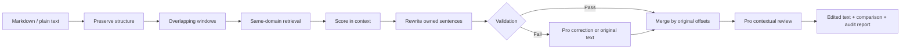

<p align="center">
  
</p>

<h1 align="center">Humanizer EN</h1>

<p align="center">
  <strong>Context-aware academic English editing for STEM and Finance.</strong><br>
  Overlapping sentence windows · Retrieval-guided style · Conservative validation
</p>

<p align="center">
  
  
  
  
</p>

<p align="center">
  <a href="docs/demo/README.md"><strong>Explore the demo →</strong></a> &nbsp;·&nbsp;
  <a href="#quick-start">Quick start</a> &nbsp;·&nbsp;
  <a href="docs/USAGE.md">Usage guide (Chinese)</a> &nbsp;·&nbsp;
  <a href="docs/EVALUATION.md">Evaluation</a>
</p>

---

Humanizer EN is a Python command-line tool for revising academic English while retaining the surrounding argument. It scores sentences inside overlapping contexts, retrieves traceable examples from the same discipline, and checks proposed edits before applying them to the original document.

**Current release:** a local research prototype for UTF-8 Markdown and plain text. It produces an edited document, a side-by-side HTML comparison, and a structured audit report. The demo below uses synthetic text and recorded API outputs; it is not a hosted editing service.

> Editorial scores are not AI-detection probabilities. The project does not guarantee GPTZero results, semantic equivalence, or publication readiness. Review substantive changes before using them.

## 📸 Demo

A real, recorded edit from the **synthetic Finance fixture**:

| Original | Revised |
| :--- | :--- |
| It is important to note that the estimated coefficient is 0.15. | The estimated coefficient is 0.15. |

The numeric value is retained while the introductory filler is removed. In the Science fixture, the review stage rejected a proposed edit and restored the original—reversion is part of the workflow.

**[View both examples, sentence-level changes, and recorded usage →](docs/demo/README.md)**

For a browser preview, download this repository and open [`docs/demo/index.html`](docs/demo/index.html). It is a self-contained, offline page with no API key, external scripts, or model calls. GitHub displays the HTML source; the Markdown demo above renders directly on GitHub.

## ✨ Features

| Capability | Behavior |
| :--- | :--- |
| **Contextual editing** | Default windows contain 8 sentences with a stride of 4. Each sentence belongs to exactly one editing window. |
| **Document preservation** | Original character offsets retain whitespace and structure; recognized code, display equations, headings, lists, tables, and references remain untouched. |
| **Traceable retrieval** | Local BM25 retrieves same-discipline candidates; model reranking selects up to 3 distinct papers with DOI and paragraph provenance. |
| **Model routing** | DeepSeek Flash handles ranking, scoring, and routine edits. Pro handles complex windows, one correction attempt, and final review. |
| **Validation and reversion** | Strict response schemas and checks for numbers, units, citations, inline expressions, glossary terms, and reference overlap reject invalid edits. |
| **Resumable runs** | Durable checkpoints reuse completed stages. Request budgets include retries; ambiguous transport failures are not automatically replayed. |
| **Reviewable output** | HTML comparisons and JSON reports expose scores, source status, model usage, validation issues, and reversions. |

Supported domains: **Science · Technology · Engineering · Mathematics · Finance**.

## 🏗️ Architecture



Sections and paragraph positions accompany model requests. Overlapping observations are aggregated by median; only the owning window can replace a sentence. Final review covers section and chunk boundaries and can revert affected sentences or paragraphs.

<a id="quick-start"></a>

## 🚀 Quick Start

### 1. Install

Requires **Python 3.10+** on **macOS or Linux**. Windows is not currently supported because file locking uses `fcntl`.

```bash
git clone https://github.com/SuperGokou/humanizer_samson.git
cd humanizer_samson
python3 -m venv .venv
source .venv/bin/activate
python3 -m pip install -r requirements.txt
```

Repository access is required while this project remains private.

### 2. Try it without a key or corpus

This command works in a fresh checkout. It parses the included fixture, builds windows, and exports a report without contacting a model:

```bash
python3 -m humanizer rewrite examples/finance_synthetic.md \
  --domain Finance \
  --output runs/finance-dry \
  --no-retrieval \
  --dry-run
```

Expected summary: `status: dry_run`, `sentences: 8`, `windows: 1`, `cumulative_calls: 0`.

Open `runs/finance-dry/comparison.html` to inspect the structure. A dry run does not generate rewrites or model scores.

### 3. Configure DeepSeek

If `.env` does not already exist:

```bash
cp .env.example .env
chmod 600 .env
```

Set the following values in the project-root `.env`:

```dotenv
DEEPSEEK_API_KEY=your_key_here
DEEPSEEK_BASE_URL=https://api.deepseek.com
DEEPSEEK_MODEL=deepseek-flash
DEEPSEEK_COMPLEX_MODEL=deepseek-v4-pro
DEEPSEEK_REVIEW_MODEL=deepseek-v4-pro
```

The loader resolves `.env` relative to the project, not the working directory. Environment variables override file values. Credentials and run outputs are excluded from Git. Only DeepSeek is implemented; the optional NVIDIA variable in the template is not used by this pipeline.

### 4. Run a bounded rewrite

To try the model without building a corpus first:

```bash
python3 -m humanizer rewrite examples/finance_synthetic.md \
  --domain Finance \
  --output runs/finance-live \
  --no-retrieval \
  --glossary examples/glossary.json \
  --max-calls 12
```

This command sends the input to DeepSeek and may incur API charges. To use retrieval, prepare your local corpus below, omit `--no-retrieval`, and choose the appropriate corpus-review mode.

## 📚 Corpus & Incremental Import

The development corpus contains **1,000 bibliographic records**, approximately 200 for each discipline, with publication years through **2021**. This is a local collection—not a dataset bundled with a fresh clone.

| Local corpus snapshot | Count |
| :--- | ---: |
| Bibliographic records | 1,000 |
| Papers with a primary full-text asset | 528 |
| Original assets, including alternate formats | 550 |
| Processed papers | 527 |
| Papers contributing candidate sentences | 299 |
| Candidate sentences | 78,370 |
| Approved `ready` sentences | 0 |

Counts describe the development snapshot documented in [acceptance evidence](docs/ACCEPTANCE.md). Candidate papers still require quality review; other papers may need license review or better text extraction. By default, the editor requires an approved index and fails if it is empty.

Add your own records or authorized source files to `corpus/inbox/`, then run:

```bash
python3 corpus/scripts/manage.py import corpus/inbox
python3 corpus/scripts/manage.py organize
python3 corpus/scripts/manage.py report
```

The manager supports incremental import, DOI and content-hash deduplication, provenance, review decisions, and snapshots. PDF corpus extraction additionally requires Poppler's `pdftotext`. See the [corpus guide](corpus/README.md) for formats, downloads, and approval steps.

For experiments that explicitly permit candidates:

```bash
python3 -m humanizer rewrite examples/finance_synthetic.md \
  --domain Finance \
  --output runs/finance-retrieval \
  --allow-candidates \
  --glossary examples/glossary.json \
  --max-calls 12
```

`--allow-candidates` does not bypass license holds or fabricate references. Candidate status remains visible in the report.

## 📦 Outputs & Recovery

| File | Purpose |
| :--- | :--- |
| `rewritten.md` | Revised text, retaining original structure; incomplete runs remain drafts. |
| `comparison.html` | Escaped, side-by-side sentence comparison with scores and reference context. |
| `report.json` | Full observations, provenance, validation issues, calls, and token usage. |
| `checkpoint.json` | Durable stage cache for compatible resumptions. |
| `evaluation.csv` | Blank fields for genuine external detector results; no fabricated scores. |

Use `--resume` with the **same input and configuration**, pointing at the existing output directory:

```bash
python3 -m humanizer rewrite examples/finance_synthetic.md \
  --domain Finance \
  --output runs/finance-live \
  --no-retrieval \
  --glossary examples/glossary.json \
  --max-calls 12 \
  --resume
```

The new budget applies to the current invocation; reports retain cumulative calls. Changes to input, models, glossary, index, prompt version, or window settings require a new run. An `uncertain` request may already have completed or incurred charges, so it is not automatically replayed.

| Exit code | Meaning |
| :--- | :--- |
| `0` | `complete` or local `dry_run` |
| `1` | `incomplete` or `uncertain`; inspect the report |
| `2` | Invalid input, configuration, corpus, or output directory |

## 🧪 Validation & Limitations

- **65 offline tests passed** at the implementation acceptance checkpoint, including a fresh checkout.
- Independent review found three material defects; regression tests now cover inline protected spans, stale source provenance, and section/paragraph context.
- Recorded synthetic API runs demonstrate the workflow, not writing-quality gains across real papers. The latest recorded live samples use prompt `contextual-2`; current code uses `contextual-3`, verified offline and against the local corpus.
- Rules cannot prove semantic equivalence. Sentence segmentation, unusual markup, numeric-object associations, and domain terminology still require review.
- No DOCX/PDF document-editing interface, hosted backend, automatic GPTZero submission, or full-web plagiarism check is included.

Run the tests:

```bash
python3 -m unittest discover -s tests -v
```

See [evaluation methodology](docs/EVALUATION.md) for original / no-retrieval / retrieval comparisons and human review criteria.

## 🗂️ Repository Guide

```text
humanizer/           Parsing, retrieval, model client, validation, pipeline, CLI
corpus/scripts/      Incremental corpus management
corpus/templates/    Import templates
examples/            Synthetic fixtures and glossary
scripts/             Demo-page generation from checked-in synthetic snapshots
docs/demo/           GitHub-readable demo and offline HTML preview
tests/               Offline unit and integration tests
```

**Documentation:** [Usage (Chinese)](docs/USAGE.md) · [Corpus maintenance](corpus/README.md) · [Evaluation](docs/EVALUATION.md) · [Acceptance](docs/ACCEPTANCE.md) · [Design](docs/superpowers/specs/2026-09-25-contextual-rewrite-design.md)
